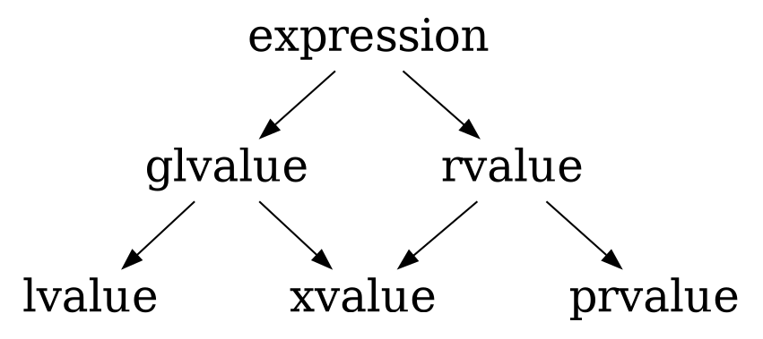

# 7.2.1 Value category [basic.lval]

[Contents](README.md) · up: [7.2 Properties of expressions \[expr.prop\]](expr.prop.md) · prev: [7.2 Properties of expressions \[expr.prop\]](expr.prop.md) · next: [7.2.2 Type \[expr.type\]](expr.type.md)

**1** Expressions are categorized according to the taxonomy in [Figure 1](basic.lval.md#fig:basic.lval).

<a id="fig:basic.lval"></a>
**Figure 1: Expression category taxonomy** [fig:basic.lval]



- A *glvalue* is an expression whose evaluation determines the identity of an object, bit-field, or function.
- A *prvalue* is an expression whose evaluation initializes an object or a bit-field, or computes the value of an operand of an operator, as specified by the context in which it appears, or an expression that has type *cv* `void`.
- An *xvalue* is a glvalue that denotes an object or bit-field whose resources can be reused (usually because it is near the end of its lifetime).
- An *lvalue* is a glvalue that is not an xvalue.
- An *rvalue* is a prvalue or an xvalue.

**2** Every expression belongs to exactly one of the fundamental classifications in this taxonomy: lvalue, xvalue, or prvalue. This property of an expression is called its *value category*. [*Note 1*: The discussion of each built-in operator in [[expr.compound]](expr.compound.md) indicates the category of the value it yields and the value categories of the operands it expects. For example, the built-in assignment operators expect that the left operand is an lvalue and that the right operand is a prvalue and yield an lvalue as the result. User-defined operators are functions, and the categories of values they expect and yield are determined by their parameter and return types. — *end note*]

**3** [*Note 2*: Historically, lvalues and rvalues were so-called because they could appear on the left- and right-hand side of an assignment (although this is no longer generally true); glvalues are “generalized” lvalues, prvalues are “pure” rvalues, and xvalues are “eXpiring” lvalues. Despite their names, these terms classify expressions, not values. — *end note*]

**4** [*Note 3*: An expression is an xvalue if it is:

- the result of calling a function, whether implicitly or explicitly, whose return type is an rvalue reference to object type ([[expr.call]](expr.call.md)),
- a cast to an rvalue reference to object type ([[expr.type.conv]](expr.type.conv.md), [[expr.dynamic.cast]](expr.dynamic.cast.md), [[expr.static.cast]](expr.static.cast.md) [[expr.reinterpret.cast]](expr.reinterpret.cast.md), [[expr.const.cast]](expr.const.cast.md), [[expr.cast]](expr.cast.md)),
- a subscripting operation with an xvalue array operand ([[expr.sub]](expr.sub.md)),
- a class member access expression designating a non-static data member of non-reference type in which the object expression is an xvalue ([[expr.ref]](expr.ref.md)), or
- a `.*` pointer-to-member expression in which the first operand is an xvalue and the second operand is a pointer to data member ([[expr.mptr.oper]](expr.mptr.oper.md)).

In general, the effect of this rule is that named rvalue references are treated as lvalues and unnamed rvalue references to objects are treated as xvalues; rvalue references to functions are treated as lvalues whether named or not. — *end note*]

[*Example 1*:

```cpp
struct A {
  int m;
};
A&& operator+(A, A);
A&& f();

A a;
A&& ar = static_cast<A&&>(a);
```

The expressions `f()`, `f().m`, `static_cast<A&&>(a)`, and `a + a` are xvalues. The expression `ar` is an lvalue. — *end example*]

**5** The *result* of a glvalue is the entity denoted by the expression. The *result* of a prvalue is the value that the expression stores into its context; a prvalue that has type *cv* `void` has no result. A prvalue whose result is the value *V* is sometimes said to have or name the value *V*. The *result object* of a prvalue is the object initialized by the prvalue; a non-discarded prvalue that is used to compute the value of an operand of a built-in operator or a prvalue that has type *cv* `void` has no result object. [*Note 4*: Except when the prvalue is the operand of a *decltype-specifier*, a prvalue of class or array type always has a result object. For a discarded prvalue that has type other than *cv* `void`, a temporary object is materialized; see [[expr.context]](expr.context.md). — *end note*]

**6** Whenever a glvalue appears as an operand of an operator that expects a prvalue for that operand, the lvalue-to-rvalue ([[conv.lval]](conv.lval.md)), array-to-pointer ([[conv.array]](conv.array.md)), or function-to-pointer ([[conv.func]](conv.func.md)) standard conversions are applied to convert the expression to a prvalue. [*Note 5*: An attempt to bind an rvalue reference to an lvalue is not such a context; see [[dcl.init.ref]](dcl.init.ref.md). — *end note*] [*Note 6*: Because cv-qualifiers are removed from the type of an expression of non-class type when the expression is converted to a prvalue, an lvalue of type `const int` can, for example, be used where a prvalue of type `int` is required. — *end note*] [*Note 7*: There are no prvalue bit-fields; if a bit-field is converted to a prvalue ([[conv.lval]](conv.lval.md)), a prvalue of the type of the bit-field is created, which might then be promoted ([[conv.prom]](conv.prom.md)). — *end note*]

**7** Whenever a prvalue appears as an operand of an operator that expects a glvalue for that operand, the temporary materialization conversion ([[conv.rval]](conv.rval.md)) is applied to convert the expression to an xvalue.

**8** The discussion of reference initialization in [[dcl.init.ref]](dcl.init.ref.md) and of temporaries in [[class.temporary]](class.temporary.md) indicates the behavior of lvalues and rvalues in other significant contexts.

**9** Unless otherwise indicated ([[dcl.type.simple]](dcl.type.simple.md)), a prvalue shall always have complete type or the `void` type; if it has a class type or (possibly multi-dimensional) array of class type, that class shall not be an abstract class ([[class.abstract]](class.abstract.md)). A glvalue shall not have type *cv* `void`. [*Note 8*: A glvalue may have complete or incomplete non-`void` type. Class and array prvalues can have cv-qualified types; other prvalues always have cv-unqualified types. See [[expr.type]](expr.type.md). — *end note*]

**10** An lvalue is *modifiable* unless its type is const-qualified or is a function type. [*Note 9*: A program that attempts to modify an object through a nonmodifiable lvalue or through an rvalue is ill-formed ([[expr.ass]](expr.ass.md), [[expr.post.incr]](expr.post.incr.md), [[expr.pre.incr]](expr.pre.incr.md)). — *end note*]

**11** If a program attempts to access ([[defns.access]](intro.defs.md#defns.access)) the stored value of an object through a glvalue whose type is not similar ([[conv.qual]](conv.qual.md)) to one of the following types the behavior is undefined:[^1]

- the dynamic type of the object,
- a type that is the signed or unsigned type corresponding to the dynamic type of the object, or
- a `char`, `unsigned char`, or `std::byte` type.

If a program invokes a defaulted copy/move constructor or copy/move assignment operator for a union of type `U` with a glvalue argument that does not denote an object of type *cv* `U` within its lifetime, the behavior is undefined. [*Note 10*: Unlike in C, C++ has no accesses of class type. — *end note*]

[^1]: The intent of this list is to specify those circumstances in which an object may or may not be aliased.
