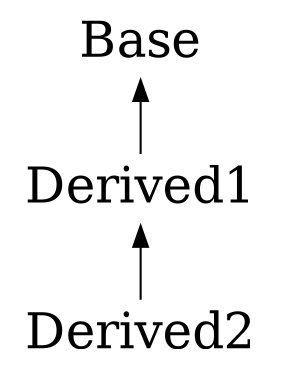

# 11.7 Derived classes [class.derived]

[Contents](README.md) · up: [11 Classes \[class\]](class.md) · prev: [11.6 Local class declarations \[class.local\]](class.local.md) · next: [11.7.1 Multiple base classes \[class.mi\]](class.mi.md)

**1** A list of base classes can be specified in a class definition using the notation:

```bnf
base-clause:
    ':' base-specifier-list
```

```bnf
base-specifier-list:
    base-specifier '...'ₒₚₜ
    base-specifier-list ',' base-specifier '...'ₒₚₜ
```

```bnf
base-specifier:
    attribute-specifier-seqₒₚₜ class-or-decltype
    attribute-specifier-seqₒₚₜ 'virtual' access-specifierₒₚₜ class-or-decltype
    attribute-specifier-seqₒₚₜ access-specifier 'virtual'ₒₚₜ class-or-decltype
```

```bnf
class-or-decltype:
    nested-name-specifierₒₚₜ type-name
    nested-name-specifier 'template' simple-template-id
    decltype-specifier
```

```bnf
access-specifier:
    'private'
    'protected'
    'public'
```

The optional *attribute-specifier-seq* appertains to the *base-specifier*.

**2** A *class-or-decltype* shall denote a (possibly cv-qualified) class type that is not an incompletely defined class ([[class.mem]](class.mem.md)); any cv-qualifiers are ignored. The class denoted by the *class-or-decltype* of a *base-specifier* is called a *direct base class* for the class being defined. During the lookup for a base class name, non-type names are ignored ([[basic.scope.hiding]](basic.scope.hiding.md)). A class `B` is a base class of a class `D` if it is a direct base class of `D` or a direct base class of one of `D`’s base classes. A class is an *indirect base class* of another if it is a base class but not a direct base class. A class is said to be (directly or indirectly) *derived* from its (direct or indirect) base classes. [*Note 1*: See [[class.access]](class.access.md) for the meaning of *access-specifier*. — *end note*] Unless redeclared in the derived class, members of a base class are also considered to be members of the derived class. Members of a base class other than constructors are said to be *inherited* by the derived class. Constructors of a base class can also be inherited as described in [[namespace.udecl]](namespace.udecl.md). Inherited members can be referred to in expressions in the same manner as other members of the derived class, unless their names are hidden or ambiguous ([[class.member.lookup]](class.member.lookup.md)). [*Note 2*: The scope resolution operator `::` ([[expr.prim.id.qual]](expr.prim.id.qual.md)) can be used to refer to a direct or indirect base member explicitly. This allows access to a name that has been redeclared in the derived class. A derived class can itself serve as a base class subject to access control; see [[class.access.base]](class.access.base.md). A pointer to a derived class can be implicitly converted to a pointer to an accessible unambiguous base class ([[conv.ptr]](conv.ptr.md)). An lvalue of a derived class type can be bound to a reference to an accessible unambiguous base class ([[dcl.init.ref]](dcl.init.ref.md)). — *end note*]

**3** The *base-specifier-list* specifies the type of the *base class subobjects* contained in an object of the derived class type. [*Example 1*:

```cpp
struct Base {
  int a, b, c;
};
```

```cpp
struct Derived : Base {
  int b;
};
```

```cpp
struct Derived2 : Derived {
  int c;
};
```

Here, an object of class `Derived2` will have a subobject of class `Derived` which in turn will have a subobject of class `Base`. — *end example*]

**4** A *base-specifier* followed by an ellipsis is a pack expansion ([[temp.variadic]](temp.variadic.md)).

**5** The order in which the base class subobjects are allocated in the most derived object ([[intro.object]](intro.object.md)) is unspecified. [*Note 3*: A derived class and its base class subobjects can be represented by a directed acyclic graph (DAG) where an arrow means “directly derived from” (see [Figure 2](class.derived.md#fig:class.dag)). An arrow need not have a physical representation in memory. A DAG of subobjects is often referred to as a “subobject lattice”.

<a id="fig:class.dag"></a>
**Figure 2: Directed acyclic graph** [fig:class.dag]



— *end note*]

**6** [*Note 4*: Initialization of objects representing base classes can be specified in constructors; see [[class.base.init]](class.base.init.md). — *end note*]

**7** [*Note 5*: A base class subobject might have a layout ([[basic.stc]](basic.stc.md)) different from the layout of a most derived object of the same type. A base class subobject might have a polymorphic behavior ([[class.cdtor]](class.cdtor.md)) different from the polymorphic behavior of a most derived object of the same type. A base class subobject may be of zero size ([[class]](class.md)); however, two subobjects that have the same class type and that belong to the same most derived object must not be allocated at the same address ([[expr.eq]](expr.eq.md)). — *end note*]

## Subclauses

- [11.7.1 Multiple base classes \[class.mi\]](class.mi.md)
- [11.7.2 Virtual functions \[class.virtual\]](class.virtual.md)
- [11.7.3 Abstract classes \[class.abstract\]](class.abstract.md)
