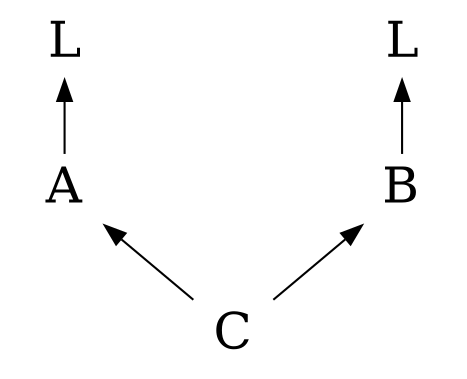
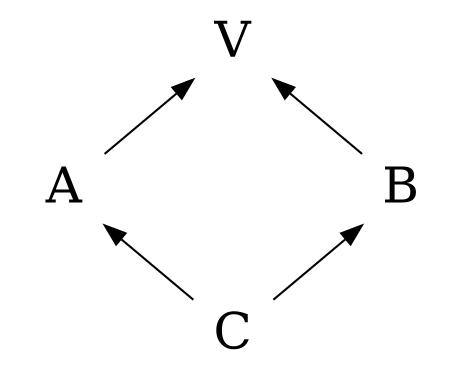
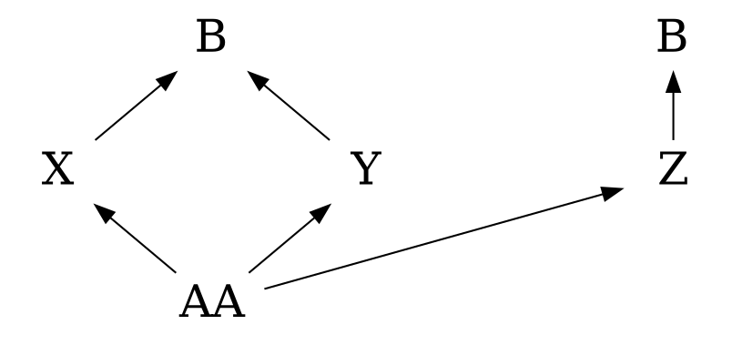

# 11.7.1 Multiple base classes [class.mi]

[Contents](README.md) · up: [11.7 Derived classes \[class.derived\]](class.derived.md) · prev: [11.7 Derived classes \[class.derived\]](class.derived.md) · next: [11.7.2 Virtual functions \[class.virtual\]](class.virtual.md)

**1** A class can be derived from any number of base classes. [*Note 1*: The use of more than one direct base class is often called multiple inheritance. — *end note*] [*Example 1*:

```cpp
class A { /* ... */ };
class B { /* ... */ };
class C { /* ... */ };
class D : public A, public B, public C { /* ... */ };
```

— *end example*]

**2** [*Note 2*: The order of derivation is not significant except as specified by the semantics of initialization by constructor ([[class.base.init]](class.base.init.md)), cleanup ([[class.dtor]](class.dtor.md)), and storage layout ([[class.mem]](class.mem.md), [[class.access.spec]](class.access.spec.md)). — *end note*]

**3** A class shall not be specified as a direct base class of a derived class more than once. [*Note 3*: A class can be an indirect base class more than once and can be a direct and an indirect base class. There are limited things that can be done with such a class. The non-static data members and member functions of the direct base class cannot be referred to in the scope of the derived class. However, the static members, enumerations and types can be unambiguously referred to. — *end note*] [*Example 2*:

```cpp
class X { /* ... */ };
class Y : public X, public X { /* ... */ };             // error
```

```cpp
class L { public: int next;  /* ... */ };
class A : public L { /* ... */ };
class B : public L { /* ... */ };
class C : public A, public B { void f(); /* ... */ };   // well-formed
class D : public A, public L { void f(); /* ... */ };   // well-formed
```

— *end example*]

**4** A base class specifier that does not contain the keyword `virtual` specifies a *non-virtual base class*. A base class specifier that contains the keyword `virtual` specifies a *virtual base class*. For each distinct occurrence of a non-virtual base class in the class lattice of the most derived class, the most derived object ([[intro.object]](intro.object.md)) shall contain a corresponding distinct base class subobject of that type. For each distinct base class that is specified virtual, the most derived object shall contain a single base class subobject of that type.

**5** [*Note 4*: For an object of class type `C`, each distinct occurrence of a (non-virtual) base class `L` in the class lattice of `C` corresponds one-to-one with a distinct `L` subobject within the object of type `C`. Given the class `C` defined above, an object of class `C` will have two subobjects of class `L` as shown in [Figure 3](class.mi.md#fig:class.nonvirt).

<a id="fig:class.nonvirt"></a>
**Figure 3: Non-virtual base** [fig:class.nonvirt]



In such lattices, explicit qualification can be used to specify which subobject is meant. The body of function `C::f` could refer to the member `next` of each `L` subobject:

```cpp
void C::f() { A::next = B::next; }      // well-formed
```

Without the `A::` or `B::` qualifiers, the definition of `C::f` above would be ill-formed because of ambiguity ([[class.member.lookup]](class.member.lookup.md)). — *end note*]

**6** [*Note 5*: In contrast, consider the case with a virtual base class:

```cpp
class V { /* ... */ };
class A : virtual public V { /* ... */ };
class B : virtual public V { /* ... */ };
class C : public A, public B { /* ... */ };
```

<a id="fig:class.virt"></a>
**Figure 4: Virtual base** [fig:class.virt]



For an object `c` of class type `C`, a single subobject of type `V` is shared by every base class subobject of `c` that has a `virtual` base class of type `V`. Given the class `C` defined above, an object of class `C` will have one subobject of class `V`, as shown in [Figure 4](class.mi.md#fig:class.virt). — *end note*]

**7** [*Note 6*: A class can have both virtual and non-virtual base classes of a given type.

```cpp
class B { /* ... */ };
class X : virtual public B { /* ... */ };
class Y : virtual public B { /* ... */ };
class Z : public B { /* ... */ };
class AA : public X, public Y, public Z { /* ... */ };
```

For an object of class `AA`, all `virtual` occurrences of base class `B` in the class lattice of `AA` correspond to a single `B` subobject within the object of type `AA`, and every other occurrence of a (non-virtual) base class `B` in the class lattice of `AA` corresponds one-to-one with a distinct `B` subobject within the object of type `AA`. Given the class `AA` defined above, class `AA` has two subobjects of class `B`: `Z`’s `B` and the virtual `B` shared by `X` and `Y`, as shown in [Figure 5](class.mi.md#fig:class.virtnonvirt).

<a id="fig:class.virtnonvirt"></a>
**Figure 5: Virtual and non-virtual base** [fig:class.virtnonvirt]



— *end note*]
