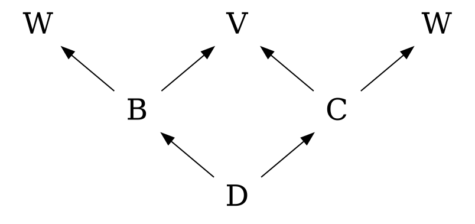

# 11.8 Member name lookup [class.member.lookup]

[Contents](../README.md) · up: [11 Classes \[class\]](class.md) · prev: [11.7.3 Abstract classes \[class.abstract\]](class.abstract.md) · next: [11.9 Member access control \[class.access\]](class.access.md)

**1** Member name lookup determines the meaning of a name (*id-expression*) in a class scope ([[basic.scope.class]](../basic/basic.scope.class.md)). Name lookup can result in an ambiguity, in which case the program is ill-formed. For an *unqualified-id*, name lookup begins in the class scope of `this`; for a *qualified-id*, name lookup begins in the scope of the *nested-name-specifier*. Name lookup takes place before access control ([[basic.lookup]](../basic/basic.lookup.md), [[class.access]](class.access.md)).

**2** The following steps define the result of name lookup for a member name `f` in a class scope `C`.

**3** The *lookup set* for `f` in `C`, called *S*(*f*,*C*), consists of two component sets: the *declaration set*, a set of members named `f`; and the *subobject set*, a set of subobjects where declarations of these members (possibly including *using-declaration*s) were found. In the declaration set, *using-declaration*s are replaced by the set of designated members that are not hidden or overridden by members of the derived class ([[namespace.udecl]](../dcl/namespace.udecl.md)), and type declarations (including injected-class-names) are replaced by the types they designate. *S*(*f*,*C*) is calculated as follows:

**4** If `C` contains a declaration of the name `f`, the declaration set contains every declaration of `f` declared in `C` that satisfies the requirements of the language construct in which the lookup occurs. [*Note 1*: Looking up a name in an *elaborated-type-specifier* ([[basic.lookup.elab]](../basic/basic.lookup.elab.md)) or *base-specifier* ([[class.derived]](class.derived.md)), for instance, ignores all non-type declarations, while looking up a name in a *nested-name-specifier* ([[basic.lookup.qual]](../basic/basic.lookup.qual.md)) ignores function, variable, and enumerator declarations. As another example, looking up a name in a *using-declaration* ([[namespace.udecl]](../dcl/namespace.udecl.md)) includes the declaration of a class or enumeration that would ordinarily be hidden by another declaration of that name in the same scope. — *end note*] If the resulting declaration set is not empty, the subobject set contains `C` itself, and calculation is complete.

**5** Otherwise (i.e., `C` does not contain a declaration of `f` or the resulting declaration set is empty), *S*(*f*,*C*) is initially empty. If `C` has base classes, calculate the lookup set for `f` in each direct base class subobject *B*<sub>*i*</sub>, and merge each such lookup set *S*(*f*,*B*<sub>*i*</sub>) in turn into *S*(*f*,*C*).

**6** The following steps define the result of merging lookup set *S*(*f*,*B*<sub>*i*</sub>) into the intermediate *S*(*f*,*C*):

- If each of the subobject members of *S*(*f*,*B*<sub>*i*</sub>) is a base class subobject of at least one of the subobject members of *S*(*f*,*C*), or if *S*(*f*,*B*<sub>*i*</sub>) is empty, *S*(*f*,*C*) is unchanged and the merge is complete. Conversely, if each of the subobject members of *S*(*f*,*C*) is a base class subobject of at least one of the subobject members of *S*(*f*,*B*<sub>*i*</sub>), or if *S*(*f*,*C*) is empty, the new *S*(*f*,*C*) is a copy of *S*(*f*,*B*<sub>*i*</sub>).
- Otherwise, if the declaration sets of *S*(*f*,*B*<sub>*i*</sub>) and *S*(*f*,*C*) differ, the merge is ambiguous: the new *S*(*f*,*C*) is a lookup set with an invalid declaration set and the union of the subobject sets. In subsequent merges, an invalid declaration set is considered different from any other.
- Otherwise, the new *S*(*f*,*C*) is a lookup set with the shared set of declarations and the union of the subobject sets.

**7** The result of name lookup for `f` in `C` is the declaration set of *S*(*f*,*C*). If it is an invalid set, the program is ill-formed. [*Example 1*:

```cpp
struct A { int x; };                    // S(x,A) = { { A::x }, { A } }
struct B { float x; };                  // S(x,B) = { { B::x }, { B } }
struct C: public A, public B { };       // S(x,C) = { invalid, { A in C, B in C } }
struct D: public virtual C { };         // S(x,D) = S(x,C)
struct E: public virtual C { char x; }; // S(x,E) = { { E::x }, { E } }
struct F: public D, public E { };       // S(x,F) = S(x,E)
int main() {
  F f;
  f.x = 0;                              // OK, lookup finds E::x
}
```

*S*(*x*,*F*) is unambiguous because the `A` and `B` base class subobjects of `D` are also base class subobjects of `E`, so *S*(*x*,*D*) is discarded in the first merge step. — *end example*]

**8** If the name of an overloaded function is unambiguously found, overload resolution ([[over.match]](../over/over.match.md)) also takes place before access control. Ambiguities can often be resolved by qualifying a name with its class name. [*Example 2*:

```cpp
struct A {
  int f();
};
```

```cpp
struct B {
  int f();
};
```

```cpp
struct C : A, B {
  int f() { return A::f() + B::f(); }
};
```

— *end example*]

**9** [*Note 2*: A static member, a nested type or an enumerator defined in a base class `T` can unambiguously be found even if an object has more than one base class subobject of type `T`. Two base class subobjects share the non-static member subobjects of their common virtual base classes. — *end note*] [*Example 3*:

```cpp
struct V {
  int v;
};
struct A {
  int a;
  static int   s;
  enum { e };
};
struct B : A, virtual V { };
struct C : A, virtual V { };
struct D : B, C { };

void f(D* pd) {
  pd->v++;          // OK: only one v (virtual)
  pd->s++;          // OK: only one s (static)
  int i = pd->e;    // OK: only one e (enumerator)
  pd->a++;          // error: ambiguous: two as in D
}
```

— *end example*]

**10** [*Note 3*: When virtual base classes are used, a hidden declaration can be reached along a path through the subobject lattice that does not pass through the hiding declaration. This is not an ambiguity. The identical use with non-virtual base classes is an ambiguity; in that case there is no unique instance of the name that hides all the others. — *end note*] [*Example 4*:

```cpp
struct V { int f();  int x; };
struct W { int g();  int y; };
struct B : virtual V, W {
  int f();  int x;
  int g();  int y;
};
struct C : virtual V, W { };

struct D : B, C { void glorp(); };
```

<a id="fig:class.lookup"></a>
**Figure 6: Name lookup** [fig:class.lookup]



As illustrated in [Figure 6](class.member.lookup.md#fig:class.lookup), the names declared in `V` and the left-hand instance of `W` are hidden by those in `B`, but the names declared in the right-hand instance of `W` are not hidden at all.

```cpp
void D::glorp() {
  x++;              // OK: B::x hides V::x
  f();              // OK: B::f() hides V::f()
  y++;              // error: B::y and C's W::y
  g();              // error: B::g() and C's W::g()
}
```

— *end example*]

**11** An explicit or implicit conversion from a pointer to or an expression designating an object of a derived class to a pointer or reference to one of its base classes shall unambiguously refer to a unique object representing the base class. [*Example 5*:

```cpp
struct V { };
struct A { };
struct B : A, virtual V { };
struct C : A, virtual V { };
struct D : B, C { };

void g() {
  D d;
  B* pb = &d;
  A* pa = &d;       // error: ambiguous: C's A or B's A?
  V* pv = &d;       // OK: only one V subobject
}
```

— *end example*]

**12** [*Note 4*: Even if the result of name lookup is unambiguous, use of a name found in multiple subobjects might still be ambiguous ([[conv.mem]](../expr/conv.mem.md), [[expr.ref]](../expr/expr.ref.md), [[class.access.base]](class.access.base.md)). — *end note*] [*Example 6*:

```cpp
struct B1 {
  void f();
  static void f(int);
  int i;
};
struct B2 {
  void f(double);
};
struct I1: B1 { };
struct I2: B1 { };

struct D: I1, I2, B2 {
  using B1::f;
  using B2::f;
  void g() {
    f();                        // Ambiguous conversion of this
    f(0);                       // Unambiguous (static)
    f(0.0);                     // Unambiguous (only one B2)
    int B1::* mpB1 = &D::i;     // Unambiguous
    int D::* mpD = &D::i;       // Ambiguous conversion
  }
};
```

— *end example*]
