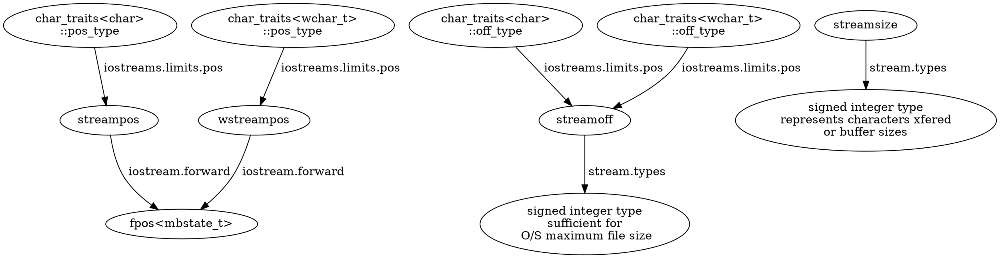

# 29.1 General [input.output.general]

[Contents](../../README.md) · up: [29 Input/output library \[input.output\]](input.output.md) · prev: [29 Input/output library \[input.output\]](input.output.md) · next: [29.2 Iostreams requirements \[iostreams.requirements\]](iostreams.requirements.md)

**1** This Clause describes components that C++ programs may use to perform input/output operations.

**2** The following subclauses describe requirements for stream parameters, and components for forward declarations of iostreams, predefined iostreams objects, base iostreams classes, stream buffering, stream formatting and manipulators, string streams, and file streams, as summarized in [Table 115](input.output.general.md#tab:iostreams.summary).

**Table 115: Input/output library summary** [tab:iostreams.summary]

|  |  |  |
| --- | --- | --- |
| [[iostreams.requirements]](iostreams.requirements.md) | Requirements |  |
| [[iostream.forward]](iostream.forward.md) | Forward declarations | `<iosfwd>` |
| [[iostream.objects]](iostream.objects.md) | Standard iostream objects | `<iostream>` |
| [[iostreams.base]](iostreams.base.md) | Iostreams base classes | `<ios>` |
| [[stream.buffers]](stream.buffers.md) | Stream buffers | `<streambuf>` |
| [[iostream.format]](iostream.format.md) | Formatting and manipulators | `<iomanip>`, `<istream>`, `<ostream>` |
| [[string.streams]](string.streams.md) | String streams | `<sstream>` |
| [[file.streams]](file.streams.md) | File streams | `<fstream>` |
| [[syncstream]](syncstream.md) | Synchronized output streams | `<syncstream>` |
| [[filesystems]](filesystems.md) | File systems | `<filesystem>` |
| [[c.files]](c.files.md) | C library files | `<cstdio>`, `<cinttypes>` |

**3** [*Note 1*: [Figure 7](input.output.general.md#fig:iostreams.streampos) illustrates relationships among various types described in this clause. A line from **A** to **B** indicates that **A** is an alias (e.g., a typedef) for **B** or that **A** is defined in terms of **B**.

**Figure 7: Stream position, offset, and size types** [fig:iostreams.streampos]

— *end note*]
